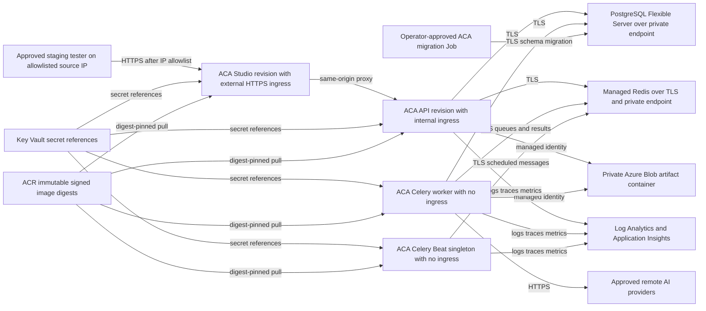

# Secure Azure Container Apps staging contract

**Status:** design contract only; not deployed or runtime-validated

**Scope:** Azure Container Apps (ACA) staging for issue #924

**Last reviewed against repository:** 2026-11-08

> This document does not authorize resource creation, image publication,
> migration, deployment, public ingress, or a change to any GitHub environment.
> The `DEPLOYMENT_ENABLED` gate remains closed as required by
> [SPLIT_RELEASE_HOLD.md](SPLIT_RELEASE_HOLD.md). No Azure command or live-cloud
> check was run to produce this contract.

This specification translates the repository's current Compose services and
runtime configuration into a **target** private staging topology. It is an input
to #925 and #926, not evidence that those resources exist. Repository evidence
is cited inline; Azure-specific choices that still require implementation or
operator validation are explicitly marked.

## Repository baseline

The current executable baseline is `docker-compose.yml`: Studio runs nginx,
the API runs FastAPI, the worker and Beat use the worker image, and PostgreSQL
and Redis are local services. The API, PostgreSQL, Redis, and Studio published
ports bind to loopback. `apps/api/Dockerfile`,
`apps/worker-orchestrator/Dockerfile`, and `apps/studio-web/Dockerfile` define
the three release images. The worker image is used with distinct worker and
Beat commands in `docker-compose.yml`.

The proposed ACA topology replaces the Compose PostgreSQL and Redis containers
with managed services. It does not include the optional Compose GPU profile;
staging must use supported remote providers. It preserves four independently
operated workloads:

- **Studio:** nginx static site and same-origin proxy, based on
  `apps/studio-web/nginx.conf.template`;
- **API:** FastAPI on container port 8000, based on `apps/api/Dockerfile`;
- **Worker:** long-running Celery worker, based on
  `apps/worker-orchestrator/Dockerfile` and
  `apps/worker-orchestrator/celery_app.py`;
- **Beat:** the same worker image with the singleton Celery Beat command from
  `docker-compose.yml`.

## Target topology

<!-- diagram: planned -->


The diagram is planned architecture, not a discovery of a live environment.
The Bicep foundation is owned by #925; the four app definitions are owned by
#926; approved runtime evidence is owned by #927.

## Resource and networking contract

### ACA environment and applications

Use one dedicated staging ACA environment integrated with a staging VNet and a
Log Analytics workspace. Do not share production data, identities, private DNS,
or secrets. Define API, Studio, Worker, and Beat as separate Container Apps so
their identities, scaling, probes, revisions, and resource limits can differ.
Define the migration runner as an ACA Job, not as an API startup hook.

Ingress defaults fail closed:

| Workload | ACA ingress | Reachability contract |
|---|---|---|
| Studio | External HTTPS only if an operator has enabled the staging IP allowlist | The only browser entry point; no direct API hostname is exposed to the Internet. |
| API | Internal | Reachable from Studio and approved jobs within the ACA environment only. Container port 8000 is not publicly published. |
| Worker | None | Outbound access only to managed dependencies and selected providers. |
| Beat | None | Outbound access only to Redis, PostgreSQL if required by scheduled task execution, Blob, Key Vault, and telemetry. |
| Migration Job | None | Manually/protected-workflow invoked; private PostgreSQL access only. |

The Studio-to-API upstream must be made configurable by #926. Today
`apps/studio-web/nginx.conf.template` uses `http://api:8000`, which is Compose
service discovery and is not an ACA contract. The same template injects one
`API_KEY` into proxied requests. `apps/api/src/shorts_api/auth.py` prefers that
header over Bearer credentials, so all browser traffic currently resolves to
the proxy key's identity. Consequently:

1. #894 (and the broader identity contract #575) blocks public multi-user
   ingress.
2. Before those blockers are proven, staging external ingress is limited to
   explicitly approved testers and an IP allowlist. It is not public beta.
3. API ingress remains internal even after Studio ingress is approved.
4. Network restrictions supplement authentication; they do not replace it.

Use VNet integration and private endpoints/private DNS for PostgreSQL, managed
Redis, Blob, and Key Vault. Disable public network access on those dependencies
unless #925 documents a narrowly scoped, time-bounded bootstrap exception. ACR
pulls use managed identity. Outbound provider traffic should pass through a
controlled egress path where feasible; its DNS names and destinations remain a
#925 operator decision.

### Managed data services

- **PostgreSQL:** Azure Database for PostgreSQL Flexible Server, TLS required,
  private endpoint/private DNS, backups enabled. `DATABASE_URL` remains the
  application interface (`packages/creator-service/creator_service/db.py` and
  `apps/api/migrations/env.py`). Application and migration principals must be
  separate; only the migration Job receives schema-change permissions.
- **Redis:** use a managed Azure Redis offering over TLS and private networking.
  Azure's product names are in transition: older material may call the service
  **Azure Cache for Redis (ACR)**, while the successor is **Azure Managed Redis
  (AMR)**. In this document, **ACR registry** always means Azure Container
  Registry; “managed Redis” means the cache/broker service. #925 must select a
  currently supported SKU and record migration/lifecycle implications.
- **Blob:** one private staging storage account/container with
  `STORAGE_BACKEND=azure_blob`. The repository currently implements Azure Blob
  with `AZURE_STORAGE_CONNECTION_STRING` and account-key SAS in
  `packages/creator-service/creator_service/object_storage.py`; managed identity
  and user-delegation SAS are **not implemented yet**. #895 must add and prove
  keyless upload/read/delete plus short-lived, read-only delegated URLs before
  this target contract can be used. `STORAGE_ALLOW_UNSIGNED_URLS` stays false.
- **Key Vault:** secrets are referenced from Container Apps using managed
  identity. No value is copied into Bicep parameters, source, image layers,
  workflow logs, or evidence artifacts. Secret versions are rotated
  deliberately and revisions restarted when required.

### Registry and image provenance

Images are stored in Azure Container Registry and referenced by immutable
`sha256` digest, never by a floating tag. The source SHA and all three selected
image digests must remain bound by the release-manifest contract in
`scripts/release_manifest.py` and [DEPLOYMENT.md](DEPLOYMENT.md). #928 owns OIDC
candidate publication, signing, scanning, and immutable ACR evidence; this
document does not claim that ACR images are signed or available. API, Worker,
Beat, Studio, and migration Job definitions consume only the approved digests.

### Observability

Route ACA platform/application logs through Azure Monitor diagnostic settings to
Log Analytics; do not use the retired shared-key Data Collector path. Export application traces
and metrics through the repository's OpenTelemetry support in
`packages/creator-service/creator_service/telemetry.py` to an approved
Application Insights/OTLP endpoint. Give API, Worker, and Beat distinct
`OTEL_SERVICE_NAME` values and common staging environment/version attributes.
Do not log database URLs, keys, provider credentials, signed Blob URLs, or
request authorization headers. Alerts should cover failed revisions, probe
failures, PostgreSQL/Redis connectivity, queue backlog and age, Beat absence or
duplication, worker release-identity expiry, Blob errors, migration failure,
storage/temporary-disk pressure, and estimated provider budget.

## Identity and least-privilege RBAC

Use distinct user-assigned managed identities (UAMIs). Do not use one shared
identity for all apps. Exact custom-role actions and scopes are an implementation
decision for #925/#926 and must be reviewed with a deny-by-default test.

| Principal | Minimum intended scope | Must not receive |
|---|---|---|
| Studio UAMI | Pull its Studio digest from the staging ACR; read only its proxy-key Key Vault secret until #894 removes that need | Blob data, database, Redis administration, provider secrets, registry push |
| API UAMI | Pull API digest; read API/database/Redis secrets; Blob data operations required by #895; send telemetry | Registry push, Key Vault administration, PostgreSQL server administration, broad subscription roles |
| Worker UAMI | Pull Worker digest; read worker/database/Redis/provider secrets; Blob data operations required by #895; send telemetry | Registry push, Key Vault administration, public storage keys, infrastructure contributor |
| Beat UAMI | Pull Worker digest; read only Beat/database/Redis/storage secrets actually required by scheduled tasks; send telemetry | Provider secrets not used by scheduled tasks, registry push, infrastructure contributor |
| Migration UAMI | Pull approved API digest; read migration database secret; execute only the separately approved migration | Runtime provider secrets, Blob data, registry push, standing app identity |
| Candidate publisher (#928) | OIDC-federated push/sign permission scoped to staging repositories | Long-lived client secret, subscription Owner, application runtime access |
| ACA pull identities | `AcrPull` at registry scope, or ABAC repository-scoped reader roles/conditions if the selected registry uses repository permissions; #925 must validate which authorization mode applies and record the actual role/scope | `AcrPush` |

Key Vault data-plane access is scoped per secret where the platform supports it.
The Blob role for API/Worker is expected to be `Storage Blob Data Contributor`
at the artifact container/account boundary needed by #895; Studio receives no
Blob role. User-delegation SAS additionally requires the delegation-key action,
which #895 must define without granting account-key access.

## Configuration contract

“Required” below means required by this target staging topology, even where
current code has a development default. **Secret reference** means a Key Vault
reference resolved by ACA; **plain configuration** means a Bicep/Container App
environment value. Configuration must be identical across API/Worker/Beat where
the storage, database, queue, schema, or release contract is shared.

### Core runtime and security

| Name | Service | Staging requirement | Secret/source | Validation and repository evidence |
|---|---|---|---|---|
| `ENVIRONMENT` | API, Worker, Beat | Required: `staging` | Plain | Enables hosted checks in `production_checks.py`; API health checks DB/Redis in `apps/api/src/shorts_api/health.py`. |
| `DATABASE_URL` | API, Worker, Beat, migration | Required, TLS DSN | Key Vault | `db.py`, `apps/api/migrations/env.py`; `production_checks.py` rejects absent/default passwords. Use separate runtime/migration credentials. |
| `DB_POOL_MIN_SIZE`, `DB_POOL_MAX_SIZE` | API, Worker | Optional, tune per replica | Plain | Integer parsing in `db.py`; defaults 2/10. Sum across max replicas must remain below server connection budget. |
| `REDIS_URL` | API, Worker, Beat | Required, TLS managed-Redis URL | Key Vault | Required for hosted checks; absence selects synchronous lightweight dispatch in `task_dispatch_adapter.py`, which is not the ACA topology. |
| `CORS_ORIGINS` | API | Required: exact Studio HTTPS origin | Plain | Comma-separated; no wildcard under `production_checks.py` and `app_factory.py`. |
| `API_KEY` | Studio only | Required until #894 changes proxy auth | Key Vault | nginx substitutes it and injects `X-API-Key` (`apps/studio-web/Dockerfile`, `nginx.conf.template`); it must correspond to a staging-only DB key. Do not give it to API as configuration. |
| `ADMIN_API_KEY` | API | Required and at least 16 characters | Key Vault | Protects admin/health detail in `auth.py`, `health.py`, and `routes/admin.py`; staging should meet the production minimum even though current validation is less strict in staging. |
| *(none)* | API | Port is image-command configuration, not an env variable | n/a | `apps/api/Dockerfile` hard-codes `uvicorn --host 0.0.0.0 --port 8000`; `API_HOST`/`API_PORT` are not read anywhere, so setting them has no effect. The ACA `targetPort` must equal 8000; exposure is controlled by internal ACA ingress. |
| `MAX_MEMORY_MB` | API, Worker | Required to match ACA limits | Plain | Parsed in API lifecycle/worker Celery startup; defaults differ (1024/4096). ACA cgroup limit is authoritative. |
| `MAX_CPU_PERCENT`, `ENABLE_PROCESS_RESOURCE_GUARD` | API | Optional; initially disabled unless tested | Plain | `apps/api/src/shorts_api/lifecycle.py`; guard is opt-in. ACA scaling/limits remain primary. |
| `SOURCE_SHA` | API, Worker, Beat, Studio, migration | Required, image-embedded reviewed SHA | Plain/image | Dockerfiles and release identity routes; must match manifest. |
| `API_IMAGE_DIGEST` | API, migration | Required diagnostic identity | Plain/release adapter | `routes/release_identity.py`; platform-observed digest remains authoritative per `DEPLOYMENT.md`. |
| `WORKER_IMAGE_DIGEST` | Worker | Required diagnostic identity | Plain/release adapter | `worker_release_identity.py` publishes only on Celery `worker_ready` and `heartbeat_sent`; active worker records expire if not refreshed. **Beat does not currently publish release identity** (it is not a worker); a Beat identity mechanism is not wired and is assigned to #926/#927. Keep Beat singleton evidence separate from worker identity records. |
| Studio API upstream | Studio | Required, internal API FQDN | Plain | **Not currently an env variable**: nginx hard-codes `http://api:8000`. #926 must add a narrowly filtered substitution without expanding nginx `$` variables. |

### Storage, retention, queue, and cost

| Name | Service | Staging requirement | Secret/source | Validation and repository evidence |
|---|---|---|---|---|
| `STORAGE_BACKEND` | API, Worker, Beat tasks | Required: `azure_blob` after #895 | Plain | Factory in `object_storage.py`; valid current values are `local`, `s3`, `azure_blob`. |
| `ARTIFACT_ROOT` | API, Worker | Optional scratch/local compatibility path only | Plain | `object_storage.py`; relative hosted paths trigger a warning. It is not durable output when Blob is selected. |
| `AZURE_STORAGE_CONTAINER`, `AZURE_STORAGE_PREFIX` | API, Worker, Beat tasks | Required container; optional prefix | Plain | Current Azure backend in `object_storage.py`; container defaults to `artifacts`. |
| `AZURE_STORAGE_CONNECTION_STRING` | API, Worker | **Forbidden in normal ACA target** | None | Current code requires this shared-key secret. #895 must replace normal ACA use with managed identity before deployment. |
| `STORAGE_ALLOW_UNSIGNED_URLS` | API | Required: `false` | Plain | `object_storage.py`; unsigned/public-object fallback is prohibited. |
| `ARTIFACT_RETENTION_DAYS` | API/Beat | Required policy decision | Plain | Artifact expiry defaults to 90 in storage/migration code; align with approved backup/legal policy. |
| `MEDIA_RETENTION_ENABLED`, `MEDIA_RETENTION_DRY_RUN` | Beat | Optional; disabled/dry-run initially | Plain | `media_retention.py`; destructive enforcement requires separate evidence. |
| `MEDIA_RETENTION_ORIGINAL_DAYS`, `MEDIA_RETENTION_INTERMEDIATE_DAYS`, `MEDIA_RETENTION_FINAL_VIDEO_DAYS`, `MEDIA_RETENTION_GRACE_DAYS` | Beat | Optional policy values | Plain | `media_retention.py`; zero disables class retention and grace defaults to 7. |
| `MEDIA_MAX_STORED_BYTES`, `MEDIA_MAX_ASSET_COUNT`, `MEDIA_MAX_RESERVED_BYTES` | API | Required finite staging quotas | Plain | `storage_policy.py`; zero currently means unlimited, which is not an acceptable unattended hosted default. |
| `MEDIA_TEMP_DISK_LOW_WATERMARK_BYTES` | API/Worker path using scratch | Required non-zero after #896/#920 validation | Plain | `storage_policy.py`; zero disables the check. Value must leave room for FFmpeg output and upload spooling. |
| `DLQ_FALLBACK_PATH` | Worker | Required contract; must not be irreplaceable replica-local state | Plain | `celery_app.py`; Compose persists it in `dlq_data`. Current default/local file is unsafe across ACA replica loss; blocked on #896. |
| `DLQ_MAX_SIZE`, `DLQ_FALLBACK_MAX_BYTES` | Worker | Required bounded values | Plain | `celery_app.py`; minimum one, current fallback-byte default 10 MiB. |
| `BROKER_EPOCH_STATE_PATH` | Worker, Beat | Required contract; must not be irreplaceable replica-local state | Plain | `celery_app.py` and Compose `dlq_data`; durable/fenced backend is blocked on #896. |
| `BROKER_RECOVERY_EPOCH_KEY`, `BROKER_EPOCH_READ_ATTEMPTS` | Worker | Optional overrides | Plain | `celery_app.py`; defaults `queue:recovery_epoch` and 3. |
| `CELERY_TASK_ROUTES` | Worker | Optional JSON override; otherwise reviewed defaults | Plain | `celery_app.py`; invalid JSON falls back to default routes, so validate before revision activation. |
| `GPU_LOCK_KEY`, `GPU_LOCK_TIMEOUT_SECONDS` | Worker | Not used in first-stage remote-provider topology | Plain | `creator_provider/gpu_lock.py`; retain only if a selected provider path actually uses the lock. |
| `BILLABLE_PROVIDER_CALLS_ENABLED` | API/Worker policy | Required: `false` until provider/budget approval | Plain | `usage_service.py`; current default permits calls. |
| `GLOBAL_MONTHLY_ESTIMATED_BUDGET_USD` | API/Worker policy | Required finite approved ceiling before billable calls | Plain | `usage_service.py`; invalid/absent means no global ceiling. |

### Remote providers and model selection

Only configure credentials for explicitly selected remote providers. Key
discovery is implemented in `packages/creator-provider/creator_provider/api_keys.py`
and provider implementations. Empty keys disable those providers.

| Name | Service | Staging requirement | Secret/source | Validation |
|---|---|---|---|---|
| `OPENAI_API_KEY`, `ANTHROPIC_API_KEY`, `GOOGLE_API_KEY`, `STABILITY_API_KEY`, `ELEVENLABS_API_KEY`, `GROQ_API_KEY` | Worker; API settings visibility | Optional per approved provider | Key Vault | Non-empty only; validate selected provider with a budget-controlled smoke. Never expose values in Studio or logs. |
| `HF_TOKEN`, `HUGGINGFACE_TOKEN` | Worker | Optional; choose one if Hugging Face is approved | Key Vault | Provider checks both names; define one canonical secret to avoid ambiguous rotation. |
| `OLLAMA_BASE_URL`, `STABLE_DIFFUSION_BASE_URL`, `TTS_QWEN3_BASE_URL`, `STT_WHISPER_BASE_URL`, `TTS_COSYVOICE_BASE_URL` | Worker/API registry | Unset/not selected for first-stage ACA | Plain | Registry defaults target Compose GPU services, which do not exist in this topology. Requests selecting them must fail clearly rather than reach stale defaults. |
| `SCRIPT_DEFAULT_MODEL`, `TTS_DEFAULT_MODEL`, `SUBTITLE_DEFAULT_MODEL`, `RENDER_DEFAULT_PROFILE` | API | Optional reviewed defaults | Plain | Read by `schemas/creator_runs.py`; defaults may reference local models, so staging selections must use available providers. |
| `OLLAMA_DEFAULT_MODEL`, `TTS_DEFAULT_VOICE`, `TTS_DEFAULT_LANGUAGE` | API/Worker provider paths | Unset unless corresponding provider selected | Plain | Provider/schema defaults only; not infrastructure health signals. |

### Telemetry and test-only switches

| Name | Service | Staging requirement | Secret/source | Validation |
|---|---|---|---|---|
| `OTEL_ENABLED` | API, Worker | Required: `true` after endpoint validation | Plain | Truthy parser in `telemetry.py`; initialization is process/fork safe. |
| `OTEL_EXPORTER_OTLP_ENDPOINT` | API, Worker | Required when telemetry enabled | Plain/private endpoint | `telemetry.py`; must resolve to the approved collector/Application Insights path. |
| `OTEL_SERVICE_NAME` | API, Worker | Required distinct names | Plain | `telemetry.py`; do not use one default for all three workloads. |
| `OTEL_ENVIRONMENT`, `OTEL_SERVICE_VERSION` | API, Worker | Required: staging and manifest/source version | Plain | `telemetry.py`. |
| `OTEL_TRACES_SAMPLER`, `OTEL_TRACES_SAMPLER_ARG` | API, Worker | Optional reviewed sampling | Plain | OpenTelemetry SDK configuration; bound cost while preserving deployment traces. |

**Beat telemetry is not currently wired.** `celery_app.py` initializes telemetry from `worker_process_init`, which the Beat process does not emit, so OTEL variables set on Beat have no effect today. Defining a Beat startup/instrumentation mechanism is assigned to #926/#927; until then Beat observability relies on platform logs and the singleton-evidence checks described above.
| `WORKER_TOPOLOGY_PROBE_ENABLED`, `WORKER_TOPOLOGY_PRODUCTION_HARD_TIME_LIMIT`, `WORKER_TOPOLOGY_ALLOW_PRODUCTION_TIMEOUT_OVERRIDE`, `WORKER_TOPOLOGY_EVIDENCE_DIR`, `WORKER_TOPOLOGY_PROVIDER_URL` | Worker | Forbidden in normal staging revisions | None | Test-only switches in worker topology probe code; #927 may use an explicitly isolated verification revision/job, never the steady-state app. |
| `NGINX_ENVSUBST_FILTER` | Studio | Required to remain narrowly scoped | Plain/image | `apps/studio-web/Dockerfile` currently limits substitution to `API_KEY`; #926 must include only the new upstream variable without expanding nginx runtime variables. |

`POSTGRES_HOST`, `POSTGRES_PORT`, `POSTGRES_DB`, `POSTGRES_USER`, and
`POSTGRES_PASSWORD` are Compose/migration fallback inputs. ACA applications use
the single Key Vault-backed `DATABASE_URL`; do not inject both forms. Likewise,
`AWS_S3_BUCKET`, `AWS_S3_REGION`, and `AWS_S3_PREFIX` are inactive when
`STORAGE_BACKEND=azure_blob`. `STUDIO_WEB_BIND` and `STUDIO_WEB_PORT` belong to
the local-server Compose overlay, not ACA.

## Filesystem and durability contract

ACA replica filesystems are ephemeral. Blob is the durable artifact store;
PostgreSQL is the metadata/system of record; managed Redis is a broker/cache,
not the sole durable business record. Never depend on a replica path surviving
restart, revision replacement, or scale-to-zero.

The current Compose topology mounts `dlq_data` for `DLQ_FALLBACK_PATH` and
`BROKER_EPOCH_STATE_PATH`. Moving those paths unchanged to ACA would lose or
split recovery state. #896 must classify and implement fenced, idempotent
durability before runtime acceptance. A shared mutable Azure Files path is not
accepted merely because it persists; locking, stale ownership, duplicates,
cancellation, and reconciliation must be proven.

FFmpeg inputs/intermediates and upload spools may use replica-local scratch only
when they are reconstructable. #896/#920 must define admission bounds, per-job
reservation, timeout behavior, low-disk rejection, and cleanup. The initial
worker maximum replica count and concurrency must be chosen so the sum of
worst-case scratch reservations fits each replica's ephemeral storage. Approved
or published output must reach Blob before local cleanup and must never be
deleted as scratch.

## Scaling and health contract

| Workload | Initial rule | Safety requirement |
|---|---|---|
| Studio | HTTP concurrency/request scaling; minimum 1 while approved testing is active | External ingress remains IP-allowlisted; scale limit protects API and proxy-key blast radius. |
| API | Internal HTTP concurrency scaling; minimum 1, conservative maximum | Per-replica DB pools must fit PostgreSQL. Readiness requires dependency health; autoscale must not bypass migration compatibility. |
| Worker | KEDA Redis queue-length rules for the named Celery queues; minimum 1 during verification, bounded maximum | Queue metric/TLS/auth shape must be validated for the selected managed Redis. Concurrency and scratch/DB/provider limits are coupled. |
| Beat | Exactly one active replica: min 1, max 1, no scale-to-zero | A deployment strategy must not overlap old/new Beat revisions. Singleton ownership must be verified by #927. |
| Migration Job | Manual/protected event only; one execution with no parallel replicas | Must complete before application revision activation and must not run on every startup. |

Use `/healthz` from `apps/api/src/shorts_api/health.py` as the API liveness
probe. Use authenticated `/health` only for an operator/dependency readiness
check because staging mode verifies PostgreSQL and Redis and limits detailed
results to admin access. #926 must define a non-secret probe method consistent
with ACA; do not put `ADMIN_API_KEY` in a public probe URL. Studio liveness and
readiness request a static local path served by nginx. Worker readiness is not
an HTTP probe today: require a process/startup probe plus Celery/broker evidence
and the expiring release identity from `worker_release_identity.py`. Beat needs
process/startup health plus observed scheduled-task evidence. Exact probe
commands, thresholds, and grace periods remain unvalidated until #926/#927.

## Revision, migration, promotion, and rollback

Use **single revision mode** for steady-state API, Worker, Beat, and Studio so
only one revision receives traffic/work. Do not use concurrent Beat revisions.
For an approved canary, API/Studio may temporarily use multiple revision mode
and an explicit traffic split, but only #930 may define and validate that
procedure; Worker/Beat queue consumers are not made safe by HTTP traffic
weights. Return to single revision mode after evidence collection.

The ordered release contract is:

1. Exact-head CI is green and the reviewed manifest binds source SHA, schema and
   queue contracts, and immutable API/Worker/Studio digests.
2. #928 publishes/scans/signs candidate digests through OIDC after #925 exists.
3. A separately approved ACA migration Job runs the selected API image by
   digest with migration-only credentials. It verifies the current/target
   Alembic revision. Failure stops app activation.
4. #929 updates app revisions by manifest and attests platform-observed digests.
5. API and Studio become ready; Worker identity and queue behavior are checked;
   Beat remains exactly one active scheduler.
6. #930 performs private authenticated smoke and rollback gates. #927 records
   final operator-approved staging evidence.

Rollback is manifest-bound and app-only by default, as specified in
[DEPLOYMENT.md](DEPLOYMENT.md). It restores the compatible image set, not a
floating tag. A database downgrade is a distinct, protected, explicitly
approved operation. Keep additive schema where compatible. A traffic split is
not a rollback plan for Worker or Beat.

## Backup and restore

PostgreSQL Flexible Server backup/PITR, Blob versioning/soft delete, Redis data
protection appropriate to the selected broker tier, Key Vault recovery, and ACR
retention must be defined by #925. RPO, RTO, retention, owners, alerts, and drill
cadence remain operator decisions. Database and artifact storage form one
coordinated restore point; Redis is not the system of record.

Follow [BACKUP_RESTORE.md](BACKUP_RESTORE.md) for manifest contents,
credential exclusion, isolated restore, authorization checks, media checksum,
and FFmpeg re-render evidence. That runbook currently proves a Compose-oriented
procedure; #927 must record an approved Azure-specific restore drill. A backup
notification is not restore evidence.

## Starting-size and cost assumptions

The following are **planning assumptions only**, not measured recommendations
or authorized purchases. #925 must price the chosen region/SKUs, set budgets,
and document quota/capacity before creation; #927 must capture observed usage.

| Component | Initial assumption | Revisit signal |
|---|---|---|
| API | 0.5 vCPU, 1 GiB, min 1/max 2 | Probe latency, memory, DB pool saturation |
| Studio | 0.25 vCPU, 0.5 GiB, min 1/max 2 | HTTP concurrency and nginx memory |
| Worker | 2 vCPU, 4 GiB, min 1/max 2, low Celery concurrency | FFmpeg memory/CPU, scratch reservation, queue age, provider limits |
| Beat | 0.25 vCPU, 0.5 GiB, exactly 1 | Scheduler latency/memory only; never scale horizontally |
| Migration Job | 0.5 vCPU, 1 GiB, one replica | Migration duration/memory |
| PostgreSQL | Small burstable/general-purpose staging tier with backup/PITR | Connections, IOPS, restore objectives |
| Managed Redis | Small non-production tier that supports required TLS/private networking and queue/KEDA behavior | Queue memory, connections, failover/recovery evidence |
| Blob/Key Vault/ACR/telemetry | Lowest compliant staging configuration with retention and budget alerts | Capacity, log ingestion, restore and security requirements |

Scale-to-zero savings do not override API availability, worker verification, or
Beat singleton requirements. Provider calls, Log Analytics ingestion, private
endpoints, NAT/egress, image storage, backups, and managed database/cache are
explicit cost lines.

## Threats and unresolved risks

| Threat or risk | Required control / owner |
|---|---|
| Shared nginx `API_KEY` collapses browser users to one identity | Public ingress blocked by #894/#575; temporary staging IP allowlist and staging-only key. |
| API or managed dependencies become public | Internal API ingress; private endpoints/DNS; deny public network access; #925 policy checks. |
| Shared keys or secrets leak through IaC, env output, logs, or URLs | UAMI + Key Vault references; #895 keyless Blob/delegated URL; secret-redaction tests. |
| Cross-workspace project/artifact enumeration | Preserve `require_*_access` boundaries and 404, never 403; #927 negative smoke. |
| Floating or substituted image runs | Manifest-bound digest, signing/scan in #928, platform digest attestation in #929. |
| Two Beat revisions emit duplicate schedules | min=max=1, single revision, non-overlap activation, #927 scheduled-task evidence. |
| Worker replica loss drops DLQ/epoch/checkpoint intent | #896 fenced durable backend and outage/restart tests before acceptance. |
| FFmpeg exhausts ephemeral disk or deletes approved output | Finite quotas/reservations, low-watermark, bounded replicas/concurrency, safe cleanup under #896/#920. |
| Redis outage causes duplicate/lost work | Broker recovery epochs, idempotency/ownership fencing, managed-service recovery drill under #896/#927. |
| Migration succeeds but new revision fails | Backward-compatible migration, separate Job, app-only manifest rollback, protected DB downgrade. |
| Delegated Blob URL is overbroad or long-lived | #895 read-only, object-scoped, short expiry; no unsigned fallback; redact URL. |
| Provider abuse or unbounded spend | Minimal provider keys, disabled billable calls by default, finite budget, egress controls and alerts. |
| Telemetry exposes credentials or high-cardinality data | Existing path normalization plus redaction review, bounded sampling/retention, private exporter. |
| Backup exists but is unusable | Coordinated isolated restore and auth/media/re-render checks from `BACKUP_RESTORE.md`; Azure drill in #927. |

## Not decided or validated

This specification does **not** decide or prove:

- Azure region, subscription/resource-group names, DNS zones, CIDRs, exact
  private-endpoint layout, NAT/firewall product, Redis product/SKU, PostgreSQL
  SKU/HA mode, backup retention, RPO/RTO, log retention, or final cost;
- that nginx supports an ACA upstream variable (it does not yet), that managed
  identity Blob access/delegated URLs work (they do not yet), or that worker
  fallback state/scratch is ACA-safe (it is not yet proven);
- exact ACA probe syntax, KEDA Redis scaler compatibility, queue thresholds,
  Celery concurrency, replica limits, temporary-disk capacity, startup times,
  provider allowlists, or alert thresholds;
- that images exist in ACR, are signed, pass scans, deploy by digest, or roll
  back; that any Bicep compiles/validates; or that any staging resource exists;
- successful migration, health, Celery task, Beat schedule, FFmpeg render,
  authorized Blob download, scale/restart, backup restore, or rollback;
- public authentication or authorization safety. #894/#575 remain blockers for
  shared-user public ingress.

## Dependency and authorization gates

Infrastructure sequence: **#924 → #925 → #926 → #927**. Delivery sequence in
parallel: **#928 → #929 → #930**, with #928 following #925, #929 also requiring
#926 and #858, and #930 following #929 plus #895/#896. #927 consumes the
protected smoke/rollback work and operator-approved resources. The parent issues
#893 and #897 coordinate these children; neither parent creates a circular
prerequisite.

Nothing in this document authorizes deployment. `DEPLOYMENT_ENABLED` remains
absent/false, public ingress remains blocked, and real resource creation,
migration, smoke, and rollback each require the approvals documented in
[SPLIT_RELEASE_HOLD.md](SPLIT_RELEASE_HOLD.md) and
[DEPLOYMENT.md](DEPLOYMENT.md).

## Static verification for this contract

This documentation-only change is checked without Azure credentials:

```bash
python3 scripts/check_architecture_diagrams.py
python3 -m pytest tests/test_architecture_diagrams.py tests/test_ci_docs_contract_inventory.py -q
```

The complete docs-gate command is defined in `.github/workflows/ci.yml`. These
checks validate Markdown, links, tracked-doc inventory, and bounded Mermaid
syntax; they are not cloud deployment or runtime evidence.
